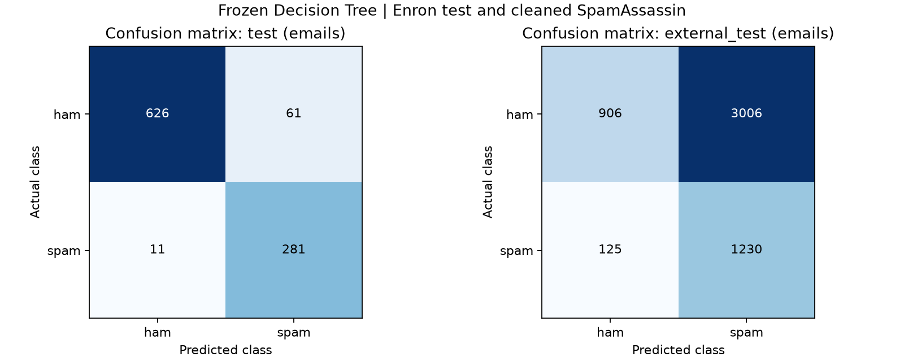
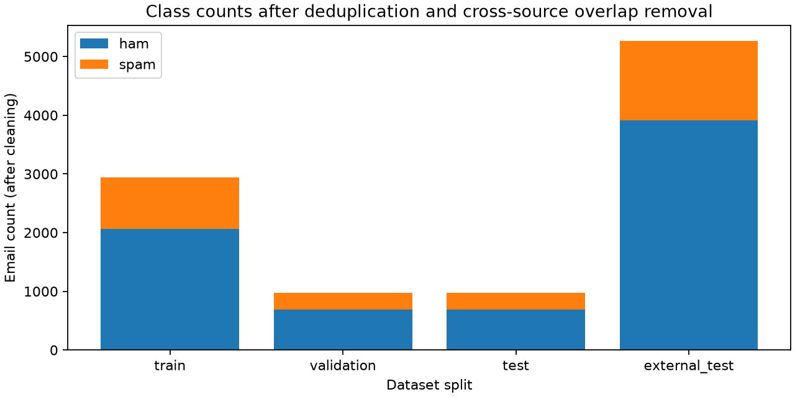

# Kết quả huấn luyện Decision Tree trên email thật

Mô hình tự viết bằng NumPy; vocabulary/Chi-square dùng thư viện. Không dùng cây sklearn để dự đoán trong release.

## Dữ liệu

Nguồn: [Enron](https://www.kaggle.com/datasets/venky73/spam-mails-dataset), [SpamAssassin](https://www.kaggle.com/datasets/nitishabharathi/email-spam-dataset).

Chi tiết làm sạch và checksum: `processed/data_quality.json` và `provenance.json`.

- enron: raw=5171; rỗng/không token=0; trùng loại=277; nhãn mâu thuẫn loại=0; giữ=4894.
- spamassassin: raw=6046; rỗng/không token=5; trùng loại=241; nhãn mâu thuẫn loại=533; giữ=5267.
- External loại trùng Enron: 0.
- train: 2936 email, ham=2059, spam=877.
- validation: 979 email, ham=686, spam=293.
- test: 979 email, ham=687, spam=292.
- external_test: 5267 email, ham=3912, spam=1355.

## Chọn cấu hình

Đã thử 18 ứng viên (K=500/1000, depth=5/10/15, leaf=1/5/10), min_samples_split=10. Chọn bằng F1 validation, rồi Precision, cây nông/ít nút; không chọn bằng test.

Chọn K=1000, parameters={"max_depth": 15, "min_samples_split": 10, "min_samples_leaf": 1}; depth thực=15, nodes=97.

## Kết quả

| Tập | Precision spam | Recall spam | F1 spam | FP | FN |
|---|---:|---:|---:|---:|---:|
| train | 0.8677 | 0.9943 | 0.9267 | 133 | 5 |
| validation | 0.8338 | 0.9420 | 0.8846 | 55 | 17 |
| test | 0.8216 | 0.9623 | 0.8864 | 61 | 11 |
| external_test | 0.2904 | 0.9077 | 0.4400 | 3006 | 125 |

## Cross-validation trên phần train

Mỗi fold fit mới vocabulary, Chi-square và cây. CV thực hiện sau chọn cấu hình như phép kiểm tra độ ổn định; không phải nested CV hoặc ước lượng độc lập cho bước lựa chọn.

- baseline_k500: F1 mean=0.8564, sample std=0.0154 (5 fold).
- selected: F1 mean=0.8884, sample std=0.0149 (5 fold).

## Phân tích lỗi và giới hạn

Các file errors.test.csv và errors.external_test.csv giữ nội dung cục bộ để đọc và lần theo luật; không đưa toàn bộ email vào Git.

External chặn nhầm 3006 thư thật, chiếm 76.84% số ham. Kết quả ngoài nguồn này cho thấy cấu hình hiện tại chưa tổng quát tốt; không chỉnh lại mô hình theo external/test trong đợt này.

- test FP: ID `enron-005056a5b26e9f8eeeed9a080c7a7362d0e9d9a3601c5080b8c9bf43e50b9f07`; đường đi: enron=không; http=không; thanks=không; hpl=không; meter=không; attached=không; gas=không; daren=không; pm=không; mmbtu=không; doc=không; questions=không; sitara=không; plant=không; julie=không; lá có 672 mẫu, tỷ lệ spam=0.811. Đây là cơ chế tạo lỗi của mẫu, không khẳng định nguyên nhân duy nhất.
- test FN: ID `enron-1ecda4bdc47fef6121f0fdaf779350e0b9d9d378360a4f0576e63f975e317629`; đường đi: enron=không; http=không; thanks=không; hpl=không; meter=không; attached=không; gas=không; daren=không; pm=không; mmbtu=không; doc=không; questions=có; following=không; hi=không; ads=không; lá có 27 mẫu, tỷ lệ spam=0.000. Đây là cơ chế tạo lỗi của mẫu, không khẳng định nguyên nhân duy nhất.
- external_test FP: ID `spamassassin-000f374f88c494adccf7dc6bd1ede84ac9068d216e0529271c7473baa410944a`; đường đi: enron=không; http=không; thanks=không; hpl=không; meter=không; attached=không; gas=không; daren=không; pm=không; mmbtu=không; doc=không; questions=không; sitara=không; plant=không; julie=không; lá có 672 mẫu, tỷ lệ spam=0.811. Đây là cơ chế tạo lỗi của mẫu, không khẳng định nguyên nhân duy nhất.
- external_test FN: ID `spamassassin-0182b0b3b0359beb234315577b1f0b440031e052fc26cc721d20aca7d5296251`; đường đi: enron=không; http=không; thanks=có; investment=không; atleast=không; hello=không; quality=không; brand=không; movies=không; lá có 411 mẫu, tỷ lệ spam=0.000. Đây là cơ chế tạo lỗi của mẫu, không khẳng định nguyên nhân duy nhất.

- Chỉ khử exact canonical duplicates, chưa xử lý mọi thư gần trùng/thread/sender; random split có thể lạc quan hơn triển khai thực tế.
- Enron và SpamAssassin là corpus lịch sử; độ chính xác không bảo đảm cho email hiện đại hoặc tiếng Việt.
- Tỷ lệ lớp ở lá chưa hiệu chuẩn. Khác biệt ngoài nguồn có thể do phân phối từ, cách làm sạch và thông tin header; chưa có thí nghiệm nhân quả để tách từng yếu tố.
- Cây nhị phân greedy không nhận zero-gain split; giới hạn đã ghi trong kiểm thử thuật toán.

## Hình

## Tái lập

Chạy `python -m spam_detector.cli train-enron --output runs/<new-name> --raw-dir data/raw`. Nếu Kaggle thay bản latest, dùng raw đã có checksum trong provenance. File summary.json là nguồn số liệu máy đọc.
